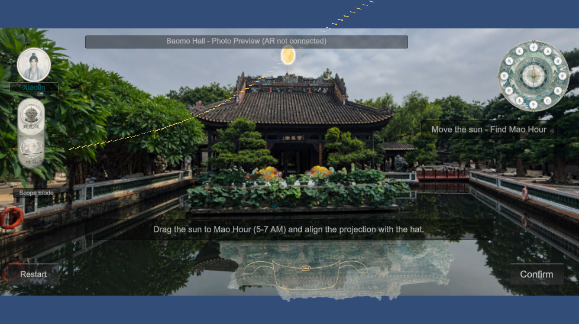

# Baomo Time Quest

A Unity heritage-exploration game prototype inspired by Baomo Garden. Players move a virtual sun to change a building projection, align it with an official-hat outline, and reveal information about Lingnan architecture.

## Current status

**This repository contains a photo-based desktop interaction prototype, not a completed on-site AR application.** The scene uses a static photograph with a transformed transparent texture. It does not recognize real buildings, track a phone, simulate physical sunlight, or provide a verified iPhone build.

### Implemented

- Mouse/pointer dragging along a virtual sun path.
- Projection translation, shear and scaling through Unity IMGUI matrices.
- Sun-position tolerance checks and completion feedback.
- Architectural information panel and timed texture-fragment animation.
- Transparent avatar, editable nickname, observation/view mode switch and map panel.
- Static decorative time dial; no compass-sensor integration.
- English runtime instructions; supplied artwork contains Chinese labels.

### Planned

- AR Foundation / ARKit integration with manual viewpoint calibration.
- Spatial anchoring and tracking feedback.
- Multi-building quests, persistent collections and scroll restoration.
- On-site calibration and iPhone validation.

## Open and run

1. Install **Unity 6000.3.10f1** using Unity Hub.
2. Download/clone this repository and open its root folder as a Unity project.
3. Let Unity restore dependencies and import assets.
4. Open `Assets/Baomo/BaomoHallPreview.unity`.
5. Click **Play**, then select the **Game** tab. A landscape aspect ratio works best.
6. Drag the sun toward the left until **Mao Hour - Aligned** appears, then click **Confirm**.
7. Close the information panel to continue. **Restart** resets the puzzle.

Click the left-side map icon to view the map and **Back to garden** to return. The observation icon toggles puzzle interaction. The nickname can be edited in the field below the avatar; it is not saved between sessions.

## Technical implementation

- **Input:** normalize pointer position to a value between 0 and 1.
- **Rendering:** `OnGUI`, transparent textures and `GUI.matrix` implement the photo-based overlay.
- **Projection:** the difference between current and target sun values controls image translation, shear and scale. This is a visual approximation, not physical shadow simulation.
- **Validation:** the implemented success check compares sun position against a configurable tolerance; it does not measure actual roof-tip/target distance.
- **Rewards:** cropped texture regions use time-based movement, rotation and alpha fading.
- **State:** flags manage dragging, completion, modal visibility and replay. Persistent save data is not implemented.

## Repository layout

| Path | Contents |
| --- | --- |
| `Assets/Baomo/BaomoHallPreview.unity` | Main playable prototype scene |
| `Assets/Baomo/Scripts/BaomoShadowPreview.cs` | Interaction, rendering, HUD and reward logic |
| `Assets/Baomo/Art` | Background photograph, projection and UI artwork |
| `Assets/Settings` | URP renderer and pipeline settings |
| `Packages` | Unity dependency manifest and lock file |
| `ProjectSettings` | Unity project configuration |
| `docs/images` | Actual prototype screenshot |

## Dependencies and limitations

The project uses URP and the Input System. The captured source project also lists Unity AI tools and MCP for Unity in its package manifest. These are development integrations, not gameplay features; package restoration can require an internet connection. No credentials are included. There is currently no standalone build or demonstration video in this repository.

## Assets and permissions

The repository includes project-supplied photography and UI artwork. No blanket open-source license is granted for those assets. Do not assume third-party artwork or packages are freely redistributable; their respective terms apply.

## Development note

The demo was developed iteratively with AI-assisted scripting and asset integration. The README distinguishes implemented runtime behavior from proposed AR functionality.
